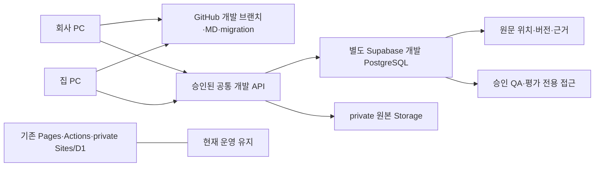

# 아키텍처 및 TASK 00 진단

TASK 01 최신 상태: 중앙 구축 및 TEST 조직 전용 무료 환경 생성은 사용자 승인됐으나 무료 활성 프로젝트 2개 한도로 신규 생성이 거절됐다. core migration/로컬 PostgreSQL 권한 검사와 개발 target 제한·원본 복원 도구를 준비했다. 실제 원격 프로젝트/DB/Storage는 미연결이며 `supabase/README.md`를 따른다. 아래 TASK 00 기록과 목표 구성을 원격 구축 완료로 해석하지 않는다.

## 기준 저장소와 기존 기능

Git 기준 루트는 이 문서가 있는 `Key-Disclosure-Points`다. 기존 작업 환경에서는 상위 `github-pages/Key-Disclosure-Points`에 중첩돼 있었고, 작업 최상위 Git에는 추적 커밋·remote가 없었다. 요구사항 원본은 상위 파일을 해시 동일하게 복사해 이 저장소에 보관한다. 별도 private Sites 소스와 legacy 분석기/원본은 상위 폴더에만 있어 **현재 Git clone만으로 복구되지 않는다**. 이를 공개 저장소로 통째 복사하지 않는다.

| 구성 | 소스/데이터 | 실제 상태 |
|---|---|---|
| 공개 UI | `src/Desk.tsx`, `snapshot.json`, `rule-reviews.json` | React 19/TS/esbuild, 최신 검토 2026.09, 현재 9건/정정 후보 2건·과거 11건 |
| 공시·규정 수집 | `scripts/collector.py`, `monitoring/state.json` | 공개 DART 목록/게시판/선정 첨부 해시. OpenDART 인증 수집은 별도 |
| Gemini | `scripts/ai_analyzer.py`, `monitoring/ai-*` | 무료 우선·캐시/분할/하루 상한. 조사 시 `needs_key`, 실제 결과 0건 |
| 개인 PDF | `PdfIntake.tsx`, `upload-store.ts` | PDF.js와 origin별 IndexedDB. 클라우드 동기화 없음 |
| 운영 화면 | `Operations.tsx`, `AiReviews.tsx` | 소스는 존재하나 공개 메뉴/라우트에서 숨김, 기존 주소는 우선 점검으로 이동 |
| 공개 배포 | `.github/workflows/update-disclosures.yml` | 평일 KST 08:00 및 main 특정 경로 push → 수집/AI/빌드/상태 commit/Pages 배포 |
| private 검토·메일 | 작업 환경 상위 `sites/disclosure-desk` | 별도 Sites + D1, revision 이력/초안·승인/EML. 실제 발송 연결·Supabase 이전 없음 |
| 과거 분석기 | 작업 환경 상위 `src`, `scripts`, `tests`, `data` | Python 표 대사/공시 검증, Git clone에 포함되지 않음 |

## 목표: 독립 개발 중앙 저장소부터

TASK 00에서는 API/DB/Storage가 연결되지 않았다. TASK 01에서는 서버 전용 Python adapter를 별도 개발 모듈로 추가하고 기존 수집기의 출력 계약을 읽는다. 정적 클라이언트에 관리자 키를 넣거나 곧바로 중앙 저장소를 운영 기준으로 바꾸지 않는다. 실시간 인증 API 호스팅 선택/운영 연결은 이후 승인 대상이다.

## 요구사항과 실제 구성의 조정

- 요구사항의 운영 대시보드 확장은 공개 운영 메뉴 복구로 해석하지 않는다. TASK 09에서 인증된 관리 화면으로 검토한다.
- 지식 사례 수집 1차에는 종근당바이오가 포함되지만 기존 실시간 모니터링 3개사를 변경하지 않는다.
- `docs/`는 **GitHub Pages 산출물**이다. 개발 문서는 루트 Markdown에 두며 `docs/`에 설계/인수인계/평가 정답을 넣지 않는다.
- IndexedDB는 PC·origin·브라우저 프로필별 저장소다. 기존 파일을 유지하고 승인된 수동 export/import 경로부터 제공한다.
- 요구사항 목표 KPI(정확도/시간 단축 등)는 측정값이 아니다. 중앙 DB·RAG·좌표 뷰어·A/B/C·정량 Rule Engine·평가 QA는 아직 완료되지 않았다.
