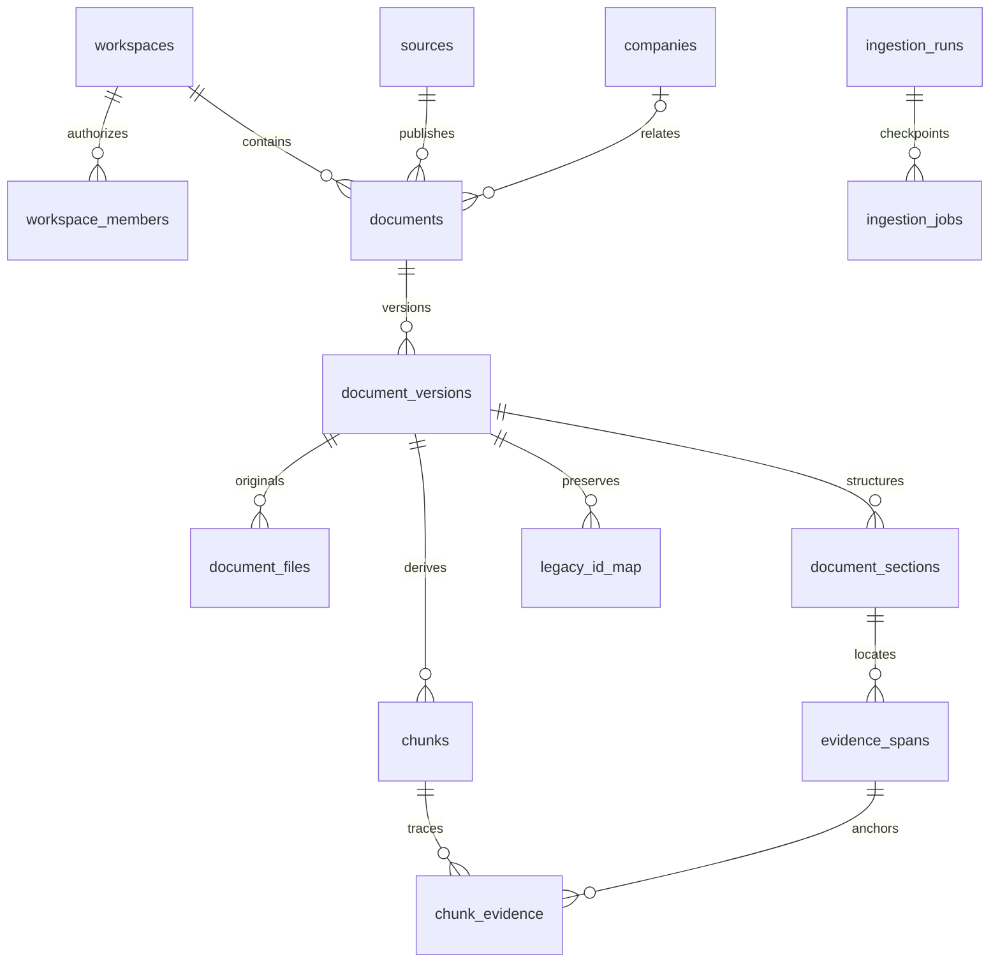

# 중앙 DB·원본 저장소 설계 초안

상태: TASK 01 core를 전용 개발 DB에 적용했다. 법령 원본 2개와 버전·근거·기존 ID의 연결을 검증했다. TASK 02에서는 `scripts/case_pack.py --anchor`로 원본 해시, 버전, PDF의 0부터 시작하는 페이지 인덱스, 공백을 제거한 텍스트의 인용 범위를 조회한다. 화면의 PDF 좌표와 HTML 문단·표·셀 위치는 후속 작업이다. 실제 적용 이력과 권한은 `supabase/README.md`를 따른다.

## 최소 ERD (TASK 01~02)

공개 API에 노출할 실테이블은 이름 충돌을 피하는 `kdp_` prefix를 검토한다. 아래는 논리 테이블명이다. 날짜만 있는 원문에 임의 시각을 만들지 않는다.

| 논리 테이블 | 주요 필드·제약·인덱스 |
|---|---|
| workspaces/members | workspace UUID, user UUID, trusted role, revision. unique(workspace,user). 자기 등록·권한 상승 금지 |
| sources | UUID, official URL, publisher, legal nature, rights status, transfer approval, approved by/at. 출처 확인과 이전 승인은 별도 |
| companies | UUID, 기존 회사 ID, DART corp code, market. unique(corp code). 미확인 값 null |
| documents | UUID, workspace, source/company, type, title, canonical identity. unique(workspace,source,identity). 원본/파생물 구분 |
| document_versions | UUID, document/workspace, receipt, published/effective/collected, date precision, correction/review/processing status, parser version, supersedes. unique(document,content hash). 접수 버전과 법적 정정 관계 구분 |
| document_files | UUID, version/workspace, bucket/path, MIME, size bigint, sha256, artifact role, rights/approval, verification state. unique(bucket,path). 해시는 동일성 검사이며 승인 아님 |
| sections/evidence_spans | version/workspace, section/legacy evidence ID, exact text, offset, PDF page index/label/boxes/rotation, HTML table/row/cell/anchor, verification. unique(version,legacy ID). index(version,section) |
| chunks/chunk_evidence | version, chunker version, ordinal, text, 관련 evidence. unique(version,chunker,ordinal). 근거 없는 chunk ready 금지 |
| legacy_id_map | old system/ID, version UUID, evidence UUID, old hash, mapping type. unique(workspace,system,old ID,old version/hash). 기존 ID의 다른 버전 보존 |
| ingestion_runs/jobs | UUID, idempotency key, stage, attempts, checkpoint, expected revision, safe error, created/updated. unique(workspace,idempotency key), index(status,next attempt) |

모든 tenant 자식 FK는 `(workspace_id, parent_id)` 복합 FK로 다른 workspace의 부모에 연결하지 못하게 한다. FK 조회열에 인덱스를 둔다. 문서 삭제는 restrict 기본값이며 원본/판단 이력을 cascade 삭제하지 않는다. 검색/평가 자료를 JSON blob 하나로 합치지 않는다.

## ID와 원본 불변성

`scripts/central_contract.py`는 순수 로컬 계약 예시다. source URL+legacy identity의 UUIDv5 문서 ID, 문서 ID+SHA-256의 버전 ID를 사용한다. 최종 문서 식별 규칙은 TASK 01에서 확정한다. receipt가 다른 정정 공시를 자동으로 동일 문서 대체 관계로 합치지 않는다. 별도 `document_relations`에 원문으로 확인된 정정 관계를 등록한다.

Storage 경로는 `originals/{document_id}/{version_id}/{sha256}.{ext}`이며 실제 bucket 안에서는 `{workspace_id}/` prefix를 추가한다. INSERT만 허용하고 `upsert=false`; 새 원본이 오면 새 버전/경로다. 개인 업로드와 공식 수집 원본은 bucket/권한 분리. DB는 경로·hash·MIME·길이만 저장한다.

Storage와 PostgreSQL은 하나의 ACID transaction으로 묶이지 않는다. `discovered → staged → object_uploaded → hash_verified → parsed → indexed → ready` 상태기계와 idempotency key를 사용한다. 재다운로드 hash/길이·근거 FK가 검증된 후 DB transaction으로 ready/snapshot 활성화. 실패하면 이전 ready를 유지하고 중간 객체는 검토 큐로 남긴다. 원본은 자동 삭제하지 않는다.

두 PC의 편집은 `UPDATE ... WHERE revision = expected_revision RETURNING ...` 조건에서 1행인 경우만 성공. 0행이면 409 충돌. JSON 파일의 last-write-wins로 대체하지 않는다. 실제 SQL 동시성 테스트는 TASK 01 이후이며 현재 로컬 함수 테스트가 이를 대신하지 않는다.

## 권한·후속 확장

- 개발 DB는 독립 프로젝트. public schema는 RLS + 명시 GRANT, anon 기본 차단. Auth user의 editable metadata로 role을 결정하지 않는다.
- trusted workspace membership별 SELECT, editor/ingestor의 INSERT, revision 제어 UPDATE. 관리자는 별도 backend. `security invoker` view 사용, 공개 SECURITY DEFINER 편의 함수 금지.
- `storage.objects`: private bucket, 승인된 workspace 경로 및 파일 레코드로 SELECT/INSERT 제한. 클라이언트 UPDATE/DELETE 금지. signed URL은 인증된 API에서 짧게 발급한다.
- QA/holdout은 비공개 schema/별도 최소권한 평가 서비스로 격리한다. generic RAG/개발자 질의와 service key를 공유하지 않는다.
- TASK 02 문단/좌표, TASK 03 disclosure_cases/financial_facts/document_relations, TASK 04 이후 model/dimension/chunker별 embeddings, TASK 05 datasets/evaluation, TASK 07 rules/versions, TASK 08 snapshots/change_events를 추가한다. 큰 벡터 인덱스부터 만들지 않는다.

## migration 계획

1. 승인된 개발 project ref/Free 상태/사용자/백업 경로를 확인하고 대상 식별표를 환경변수와 대조.
2. 현재 CLI help/version을 확인해 지원 버전을 pin. CLI v3의 remote 기본값 변경을 확인하고 운영 ref를 설정하지 않는다.
3. 로컬 PostgreSQL로 core schema/RLS/Storage 정책을 반복 검증. CLI로 migration 파일 생성 후 실제 SQL·seed·rollback 문서를 Git에 저장한다.
4. 개발 DB 적용 전 advisors, PUBLIC/anon/authenticated 권한 및 workspace 간 접근 거부 테스트. 실 적용은 별도 승인.
5. 문서 관계/근거 alias/샘플 ready 검증. 운영 migration은 TASK 10 승인 전 금지.

TASK 00에서는 CLI·Docker·psql이 PATH에 없어 migration 미생성이었다. TASK 01에서 npm 경유 CLI 3.3.0 help를 확인하고 `migration new`로 파일을 생성했다. 로컬 PostgreSQL/WASM 검증은 추가됐으나 Docker Supabase stack/원격 migration list·advisors·Auth/Storage HTTP는 아직 검증하지 않았다.
