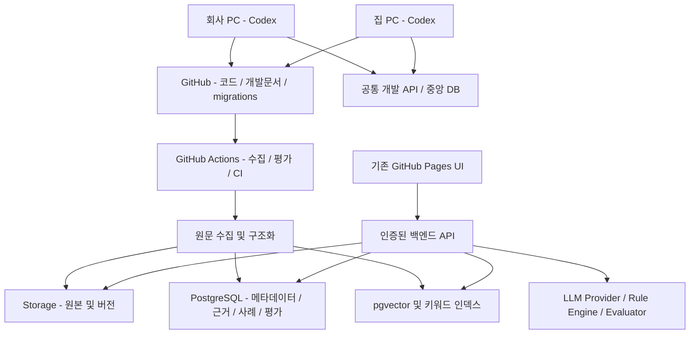

# Key Disclosure Points 2.0 — 공시 특화 AI 플랫폼 고도화 요구사항

- 문서 버전: 2.0 (통합 개정본)
- 작성 기준일: 2026-11-24
- 대상 저장소: https://github.com/GunYulePark/Key-Disclosure-Points
- 기존 배포 사이트: https://gunyulepark.github.io/Key-Disclosure-Points/
- 기존 운영 화면: https://gunyulepark.github.io/Key-Disclosure-Points/#operations
- 개발 도구: Codex
- 핵심 변경: 클라우드 중앙 DB와 원본 저장소를 개발 초기에 구축하고, 회사 PC와 개인 PC에서 같은 프로젝트를 이어서 개발할 수 있도록 한다.

> Codex 작업 지시: 이 문서는 기존 프로젝트를 고도화하기 위한 기준 요구사항이다. 현재 코드와 실제 운영 환경을 먼저 확인한다. 아래 기술과 파일 경로는 설계 방향이며, 기존 구현과 충돌하면 실제 저장소를 기준으로 변경안을 문서화한다. 한 번에 전체 시스템을 구현하거나 운영 사이트를 재구축하지 않는다. 마지막 장의 최초 작업부터 순서대로 진행한다.

## 1. 추진 목적 및 핵심 성과

기존 공시 검토실의 공시·규정 수집 및 검토 기능을 유지하면서, 제약·바이오 상장기업의 공시 업무에 특화된 AI 의사결정 지원 플랫폼으로 발전시킨다.

단순히 규정 PDF를 LLM에 업로드하는 방식이 아니라 다음 기능을 결합한다.

1. Data Pipeline: 공시·규정·FAQ·사례 자동 수집 및 구조화
2. Cloud Document Repository: 원본과 개정·정정 이력을 중앙 저장
3. Evidence Viewer: AI가 인용한 문장·표·셀을 실제 원본에서 바로 확인
4. Advanced RAG: 조항 구조, 관련 규정, 예외, 시행일 및 최신 공시를 반영한 검색
5. Rule Engine: 검증된 정량 기준, 재무정보 및 제출기한 계산
6. Disclosure Chat: 결론·근거·확인사항·후속 조치 제공
7. Evaluation Lab: 일반 LLM vs 기본 RAG vs 특화 RAG 자동 비교 및 평가
8. Feedback & Governance: 담당자 검토·승인, 판단 이력, 변경 영향 및 회귀 테스트
9. Operations Dashboard: 데이터 품질, 최신화, 비용, 장애, 평가 현황 표시
10. Multi-PC Development: GitHub 및 중앙 DB를 기반으로 회사와 집에서 동일한 개발 맥락 유지

최우선 성과는 답변 정확도 자체뿐 아니라 **사람이 실제 원문을 쉽게 검증할 수 있는지, 최신 자료를 사용하는지, 일반 AI 대비 개선 효과를 객관적으로 측정할 수 있는지**다. 최종 공시 판단 및 제출 권한은 담당자에게 있으며 시스템은 자동 공시 제출을 수행하지 않는다.

## 2. 기존 프로젝트 분석 및 보존

- 기존 React/TypeScript, Python 수집 코드, GitHub Pages/Actions, Gemini 분석, PDF.js, 브라우저 저장소 및 검토 기능의 실제 사용 여부를 소스에서 확인한다. 이전 논의에서 언급한 기능은 확인 대상이지 현재 구현 완료를 의미하지 않는다.
- `src/`, `scripts/`, `monitoring/`, `public/`, `docs/`, `tests/`, `.github/workflows/`, README, 패키지 설정 및 기존 AGENTS.md/요구사항 문서를 조사한다. 실제 경로를 기준으로 한다.
- 기존 회사별 검토, 공통 기준, 정정 검토 후보, PDF 업로드, 공식 원문 연결, 기존 AI 분석 및 운영 화면을 회귀 테스트로 보호한다.
- 기존 사용자 데이터·검토 이력·근거 ID 및 공개 사이트 URL을 함부로 삭제하거나 변경하지 않는다.
- 변경 전 baseline 빌드/테스트 결과, 배포 구조, 데이터 흐름, 의존성, 로컬 데이터 위치, 알려진 오류를 기록한다.
- 이미 유사 기능이 존재하면 통합·확장하고 중복 모듈을 만들지 않는다. 전체 프론트엔드 프레임워크 교체는 근거와 사용자 승인 없이는 하지 않는다.

## 3. 목표 아키텍처 및 기술 선택

| 영역 | 기본 선택 / 검토 대상 |
|---|---|
| 개발 및 버전관리 | Codex + GitHub, 기존 프론트엔드 유지 |
| 중앙 DB | Supabase PostgreSQL + pgvector 우선 |
| 원본 저장 | Supabase Storage 또는 호환 Object Storage |
| 백엔드 | Python FastAPI 또는 기존 환경에 적합한 서버리스 API; Python 의존성·실행시간을 고려해 선택 |
| 인증 및 접근제어 | Supabase Auth / RLS / Storage 정책 또는 회사 승인 인증 체계 |
| PDF 처리 | PyMuPDF 등 좌표 추출 도구 + 기존 PDF.js |
| XML·HTML 처리 | lxml, BeautifulSoup, 검증된 sanitizer |
| 한국어 검색 | Kiwi, BM25, 벡터 검색, RRF, reranking |
| 판단 규칙 | Python, Decimal, YAML/DB, Pydantic |
| 생성 모델 | 기존 Gemini API 우선, OpenAI 등 provider adapter 추가 가능 |
| 평가 | Promptfoo, Ragas, Pytest, Playwright 또는 호환 자체 평가기 |
| 자동화 | 기존 GitHub Actions 우선; 필요 시 승인 후 n8n/별도 worker |
| 로컬 테스트 | SQLite·fixture·임시 캐시 등; 운영의 유일한 저장소가 되지 않음 |

### 3.1 운영 형태

- GitHub Pages는 정적 UI로 유지한다. 브라우저가 서버용 API 키나 DB 관리자 키를 사용해서 직접 LLM을 호출하지 않는다.
- 실시간 채팅, 평가 실행, 사용자별 검토 저장은 인증된 API를 통해 수행한다. 백엔드가 아직 없으면 로컬/배치 모드만 제공하고 상태를 명시한다.
- Python 파싱 및 장시간 평가 작업은 GitHub Actions 또는 적절한 worker에서 실행한다. 서버리스 실행시간 제한을 초과하는 작업을 단일 요청에 넣지 않는다.
- 현재 공식 문서 및 변경 이력을 확인하여 라이브러리·모델·무료 한도·배포 방식의 호환성을 검증한다. 유료 서비스 활성화는 별도 승인 대상이다.
- AI Provider 인터페이스는 모델 ID·버전, 생성 설정, Structured Output, 토큰 사용량, 비용, 오류 및 재시도를 공통 관리한다. 모델명과 임베딩 모델을 설정으로 분리한다.

## 4. 중앙 DB 및 회사·집 개발환경 (최우선 변경사항)

### 4.1 저장 위치와 역할

| 자산 | 기준 저장소 | 비고 |
|---|---|---|
| 소스코드, 테스트, 공개 가능한 설계 문서 | GitHub | 브랜치·커밋·PR로 관리 |
| DB 스키마 변경 | GitHub의 SQL migration | 개발→검증→운영 순서 |
| PDF, XML, HTML, ZIP, 첨부파일 원본 | 중앙 Object Storage | 버전별 불변 객체, 해시 관리 |
| 규정·공시·문단·표·좌표·사례 | PostgreSQL | 원본 version ID와 연결 |
| RAG 임베딩 및 검색용 데이터 | PostgreSQL/pgvector 및 파생 인덱스 | 모델·인덱스 버전 관리 |
| 검증 질문·정답·판단 규칙 | PostgreSQL | 역할별 접근 제한, 승인 이력 |
| 질의응답·평가 결과·작업 상태 | PostgreSQL | 실행 ID 및 검토 이력 |
| API 키 및 DB 관리자 인증정보 | 승인된 Secret 관리 / 각 PC 환경변수 | GitHub 공개 파일에 금지 |
| 로컬 파일 및 브라우저 저장소 | 캐시 또는 임시 테스트 | 기준 데이터 아님 |

원본 바이너리를 DB 테이블에 대량 저장하거나 전체 원본을 GitHub에 올리지 않는다. DB에 객체 경로, 해시, 문서 버전 및 접근 권한을 저장한다. 공개 자료라도 라이선스·이용약관상 저장 및 재배포 허용 여부를 확인한다.

### 4.2 다중 PC 환경

- 회사 PC와 집 PC는 같은 GitHub 저장소 및 승인된 공통 개발 DB에 연결한다. 소스코드와 스키마 변경 이력은 Git, 실제 데이터는 DB에서 공유한다.
- 첫 설치: Git clone → 지원되는 런타임 설치 → lockfile 기준 의존성 설치 → 환경변수 구성 → 개발 DB 연결 확인 → 테스트. 실제 명령은 저장소의 OS/패키지 도구에 맞춰 README에 기록한다.
- 업무 시작: `git status`, 현재 브랜치 확인, 충돌 없는 상태에서 `git pull --ff-only` 또는 팀의 지정 브랜치 동기화, `DEVELOPMENT_STATUS.md`, `NEXT_TASK.md` 확인.
- 업무 종료: 변경사항과 비밀정보 노출 점검 → 선택적 staging → 테스트 → 커밋/푸시 → 상태 문서 및 다음 작업 갱신. `git add .`를 무조건 실행하지 않는다.
- 어느 PC에서도 로컬 사용자 이름, 절대경로, 특정 Codex 채팅 세션에 의존하지 않는다. `.env.example`, `.gitignore`, 런타임 버전, dependency lockfile, 초기 설정 스크립트를 관리한다.
- 기존 Codex 채팅이 다른 PC에 동일하게 존재한다고 가정하지 않는다. 의사결정, 재현 명령, 미해결 문제, 다음 작업, 관련 커밋/마이그레이션 ID를 저장소 문서에 남긴다.
- DB 동시 수정은 revision/updated_at 기반 충돌 검출 또는 transaction으로 제어한다. 두 PC에서 동시에 같은 수집 작업을 실행해도 중복이 생기지 않아야 한다.

### 4.3 Development / Production 분리

- 공통 개발 환경과 운영 환경은 가능한 한 독립 프로젝트 또는 독립 DB 및 별도 자격증명·Storage·권한으로 분리한다. 회사와 집은 공통 개발 환경만 사용한다.
- 승인된 공개 자료의 읽기 전용 snapshot은 개발 환경에서 활용 가능하다. 운영 DB를 직접 실험하거나 테스트 데이터를 쓰지 않는다.
- 무료 한도 때문에 독립 프로젝트 구성이 어렵다면 운영과 개발을 섞지 말고 개발 전용 DB + 기존 정적 공개 사이트 유지 또는 승인된 별도 테스트 방식으로 제한한다. 스키마 구분만으로 충분한 접근 통제가 된다고 가정하지 않는다.
- 스키마 변경은 migration 파일로 관리하며 적용 전 대상 project ref, 환경, 백업, 롤백 계획을 확인한다. 운영 migration·삭제·대량 갱신은 별도 승인.
- Supabase MCP를 사용할 경우 개발용 프로젝트에 한정하고 가능한 최소 권한/읽기 전용으로 시작한다. 운영 프로젝트 연결 또는 권한 확대는 별도 승인한다.

### 4.4 기존 로컬 데이터 마이그레이션

1. 로컬/브라우저 IndexedDB/JSON/CSV/SQLite/PDF/공시 원본/AI 검토 결과 위치와 용량을 조사하고 inventory를 생성한다.
2. 공개 자료, 회사 내부 자료, 권리 미확인 자료, 테스트 자료를 구분한다. 외부 클라우드에 이전 가능한 승인 범위를 먼저 확인한다.
3. dry-run으로 문서 수, 파일 수, 총용량, 중복, 충돌, 누락 근거, 현재 ID 및 이전 경로를 출력한다.
4. 승인된 공개 자료만 샘플로 이관한다. 원본 PDF 1개와 DART 공시 1개, 기존 근거/Chunk 및 평가 레코드 일부를 우선 대상으로 한다.
5. 원본을 백업하고 SHA-256 검증, 버전 및 기존 근거 ID 보존, ID 변경 시 mapping 테이블 생성, 참조 무결성 확인을 수행한다.
6. 업로드와 인덱싱이 성공한 뒤 DB에서 ready 상태로 전환한다. 재실행 가능한 upsert/체크포인트를 사용하고 실패 내역을 기록한다.
7. 이전 전후 건수·해시·근거 링크·검색 결과·PDF/HTML 위치를 검증한다. 이관 실패 시 마지막 정상 데이터로 복구한다.
8. 기존 로컬 데이터는 사용자 승인 전 삭제하지 않는다. 브라우저 개인 업로드 자료는 자동 전송하지 않는다.

운영 이관 전 예상 DB/Storage/인덱스 크기와 호출량을 산출한다. 무료 플랜 용량을 사실로 하드코딩하지 말고 현재 공식 정책을 확인한다. 용량 초과 예상 시 수집 범위·파생 인덱스 크기·저장 구조를 조정하거나 승인 요청한다.

## 5. 공시 지식 데이터셋 수집

### 5.1 출처 및 유형

- 법령: 자본시장법·시행령, 상법·시행령, 국가법령정보센터 (https://www.law.go.kr/)
- 거래소: KOSPI/KOSDAQ 공시규정·시행세칙·상장규정·별표·부칙, KRX 법무포털 (https://rule.krx.co.kr/), KIND (https://kind.krx.co.kr/)
- 금융감독원: 기업공시서식 작성기준, 기업공시 실무안내, FAQ, 위반 사례, DART (https://dart.fss.or.kr/)
- 제약·바이오 공시 가이드라인, 금융위·금감원·거래소 공식 설명 및 개정 공지, 상장회사협의회 실무자료(권리 확인)
- 실제 기업의 공시 및 재무정보: Open DART (https://opendart.fss.or.kr/)
- 승인 후 별도 비공개 환경에서만 내부 실무 질의 및 거래소 회신, 검토 보고서 활용.

자료의 법적 성격을 구분한다: 법률, 시행령, 거래소 규정, 시행세칙, 별지/별표, 해설·FAQ, 권고, 개정안/입법예고, 확정 개정, 공식 질의회신, 실제 공시 사례, 내부 의견. 사례가 공시됐다는 사실은 공시 의무의 법적 근거가 아니다. 코스닥 가이드라인을 코스피에 자동 적용하지 않는다.

### 5.2 기업 및 공시 유형

초기 수집 기간: 2022-01-01 이후(설정 가능). 기존 실시간 모니터링 대상과 RAG 사례 수집 대상을 분리한다.

- 1차: 종근당, 종근당홀딩스, 경보제약, 종근당바이오
- 2차: 유한양행, 한미약품, 대웅제약, 녹십자, 동아에스티, 보령, HK이노엔, 삼성바이오로직스, 셀트리온, SK바이오팜
- 3차: 앱클론, 큐로셀, 알테오젠, 리가켐바이오, 에이비엘바이오 등
- 필요 시 공시우수법인·위반 사례를 업종과 무관하게 추가한다. 시장과 기업 규모의 차이를 표시한다.

공시 유형: 임상시험 신청/승인/결과/중단, 품목허가, 기술수출·도입, 마일스톤, 계약 변경·해지, 타법인 주식 취득·처분, 유형자산 및 시설투자, 채무보증, 유상증자, CB/EB/CPS, 자기주식 취득·처분·소각, 배당·배당기준일, 공급계약, 손익구조 변동, 주주총회·정관·지배구조, 사업·반기·분기보고서, 공정공시, 풍문·조회공시, 정정·철회 및 불성실공시.

### 5.3 자동 수집 및 구조화

Open DART 공시목록, 고유번호, 공시 원문 ZIP 및 재무제표 API를 사용한다. 현재 공식 API 명세를 확인한다(예: `corpCode.xml`, `list.json`, `document.xml`, `fnlttSinglAcntAll.json`).

- 페이지네이션, 증분 수집, 접수번호 중복 방지, 조회 구간 overlap, 재시도/backoff, 호출량 제한, 실패 큐, 체크포인트, 누락 구간 재수집을 구현한다.
- 원문 확보가 불가능한 경우 공식 열람 링크와 미확보 상태를 남긴다. 허용되지 않는 다운로드/우회는 하지 않는다.
- 공시 원문에서 기업, 시장, 접수일, 사건 발생일, 이사회 결정일, 공시 유형, 거래금액, 적용 자기자본/자산/매출, 비율, 통화 및 단위, 임상 단계, 적응증, 허가 단계, 계약 조건을 구조화한다.
- 구조화 필드마다 출처 evidence_id, 추출 방식, 검증 상태를 저장한다. 모르는 값은 null, 미확인 또는 해당 없음으로 표시한다(0과 구분).
- 원문 및 표를 보존하고 AI 요약·분류·추출 결과는 별도 데이터로 저장한다. 미승인 추출 데이터가 확정 법적 판단의 근거가 되지 않도록 한다.
- 원본 파일·수집 날짜·공식 URL·접수번호·해시·문서 버전·파서 버전을 저장한다.

## 6. 문서 저장 및 데이터 모델

### 6.1 필수 논리 테이블

| 그룹 | 테이블(권장 이름) |
|---|---|
| 원본 및 문서 | sources, companies, documents, document_versions, document_files |
| 원문 구조 및 검색 | document_sections, evidence_spans, chunks, embeddings, regulation_relations, document_relations |
| 공시 및 재무 | disclosure_cases, financial_facts |
| 판단 규칙 | disclosure_rules, rule_versions |
| 질의 및 검토 | chat_sessions, chat_messages, answer_evidence, review_feedback, review_queue |
| 평가 | qa_cases, dataset_versions, evaluation_runs, evaluation_answers, evaluation_scores, retrieval_traces |
| 운영 | ingestion_runs, ingestion_jobs, change_events, index_snapshots |

기존 스키마 및 구현 규모에 맞게 정규화/통합하되 원문 재현성, 버전 관리, 데이터 분리, 참조 무결성을 훼손하지 않는다. ERD와 데이터 사전, unique/FK/index, 접근 정책을 작성한다.

### 6.2 문서 및 버전 필드

`document_id`, `document_version_id`, `title`, `document_type`, `publisher`, `company_id`, `market`, `source_url`, `receipt_no`, `published_at`, `effective_from`, `effective_to`, `collected_at`, `file_path`, `mime_type`, `sha256`, `supersedes_version_id`, `version_status`, `correction_status`, `review_status`, `access_level`, `parser_version`, `processing_status`.

- 원본은 immutable하게 보관한다. 새 버전은 기존 객체를 덮어쓰지 않는다.
- 공시 접수일과 수집일, 규정 공표일과 시행일을 구분한다. 시간이 필요한 자료는 timezone과 실제 시각의 확인 여부를 기록한다.
- 문서가 당시 공개되었는지와 법적으로 유효했는지를 별도로 추적한다. 날짜 정보가 없으면 임의 생성하지 않는다.
- 논리 경로 예시: `regulations/{document_id}/{version_id}/{hash}.pdf`, `disclosures/{company_id}/{receipt_no}/{hash}.zip`, `attachments/...`, `guidelines/...`. bucket 공개 여부는 접근 정책으로 별도 통제한다.
- 파생 데이터는 원본과 분리한다. embedding model ID/dimension, chunker 버전, parser 버전, 인덱스 snapshot ID를 관리한다.

## 7. Evidence Viewer — 원본 직접 검증

이 기능은 MVP 핵심이며 RAG 답변 생성보다 먼저 원본 위치 매핑을 검증한다.

### 7.1 UI 및 원문 이동

왼쪽에는 AI 답변, 주장별 근거 버튼, 계산, 예외 및 추가 확인사항을 표시한다. 오른쪽에는 실제 저장 원문을 표시한다. 근거 클릭 시 문서만 열거나 페이지 번호만 안내하는 것으로 완료하지 않고 **정확한 문장, 문단, 표의 행 또는 셀에 자동 이동하고 하이라이트**한다.

- 앞뒤 문맥과 상위 조항, 예외·각주 확인 가능
- 공식 원문 링크와 저장본 열람/다운로드 제공(권한 범위 내)
- 문서 버전, 시행일, 접수일, 수집일, 현재/과거/정정/철회 상태 표시
- 현재 최신본과 AI가 당시 사용한 버전을 각각 열람 가능
- 원문 근거 적절성 승인·반려 및 메모 기능
- 원본 미확보 또는 위치 불일치 시 검증 불가 표시; 그럴듯한 하이라이트 생성 금지

### 7.2 PDF

- PyMuPDF 등으로 페이지 인덱스(0-based), 인쇄 페이지 라벨, 문장/문단 텍스트, 복수 Bounding Box, 페이지 크기 및 회전 좌표계를 추출한다.
- PDF.js의 viewport 좌표 변환으로 정확히 표시한다. 확대·축소·회전·다중 페이지·줄바꿈을 테스트한다.
- 텍스트가 없는 스캔 PDF는 필요한 경우 승인된 OCR을 사용한다. OCR 텍스트와 원본 이미지, 위치 신뢰도를 분리하고 미검증 좌표는 표시한다.
- 필요 시 해당 원본 페이지의 영역 미리보기(실제 페이지에서 생성한 crop)를 제공하되 전체 원문을 함께 열 수 있어야 한다.

### 7.3 DART XML/HTML 및 표

- API 원본 ZIP/XML 및 원본 첨부를 보관한다. 자체 뷰어 표시용 HTML은 별도 변환본으로 저장한다.
- 장·절·제목·문단·표·행·셀·각주에 문서 버전 범위 내 고유 ID를 부여한다.
- 병합 셀, 단위, 숫자, 음수, 각주, 표 제목, 행/열 맥락을 유지한다. 가공으로 값이 달라지지 않았는지 fixture로 검증한다.
- 기존 해시 라우팅과 호환되는 원문 deep link를 구현한다. 예: `/#viewer/{document_version_id}/{evidence_id}`. 실제 라우터에 맞춘다.
- 문서 HTML은 sanitize하고 스크립트, 위험한 링크/속성, 외부 실행을 차단한다. ZIP 경로 탈출, XXE, 파일 크기·압축 폭탄도 방어한다.

### 7.4 근거 레코드 및 검증

`evidence_id`, `document_version_id`, `section_id`, `exact_text`, `text_start_offset`, `text_end_offset`, `page_index`, `page_label`, `bounding_boxes`, `coordinate_system`, `html_anchor_id`, `table_id`, `row_id`, `cell_id`, `source_url`, `verification_status`.

LLM은 검색 과정에서 제공받은 근거 ID로만 주장을 연결한다. 서버가 원문 문자열과 문서 버전, 위치, 해시, 사용자의 접근 권한을 검증하고 해당 원문을 렌더링한다. 존재하지 않는 ID, 임의 조항, 임의 좌표를 허용하지 않는다. 인용문 일치와 해당 규정이 실제 결론을 지지하는지는 서로 다른 검증이다. 모든 검색 Chunk는 하나 이상의 정확한 원문 위치로 역추적 가능해야 한다.

## 8. 공시 특화 Advanced RAG

### 8.1 기본 RAG와 특화 RAG 분리

기본 RAG는 비교군으로 일반적인 토큰/텍스트 Chunking, 합리적 overlap, vector top-k 검색 및 근거 기반 답변을 구현한다. 의도적으로 성능을 낮추지 않는다. 기본 및 특화 RAG에는 동일한 원본 문서 집합과 동일 snapshot을 제공한다.

특화 RAG는 다음을 추가한다.

- 조·항·호·목, 단서, 부칙, 별표, 별지서식, 표, 각주 단위 구조 기반 Chunking
- Parent-Child retrieval: 세부 조항 검색 후 상위 조항·예외·표/각주를 함께 제공
- Vector Search와 한국어 BM25/키워드 검색 병행; 조항 번호·정확 용어 검색 보존
- Metadata Filtering: 시장, 기업 규모, 판단 기준일, 공표·시행일, 문서 유형, 최신 유효 여부, 철회 및 권한
- RRF 기반 순위 결합과 reranking; 관련 조항·예외 확장 검색
- 근거 ID 기반 답변 및 검증, 정량 규칙 연결

초기에는 벡터·키워드 후보 각각 20개 내외, 최종 근거 5~10개를 실험 시작점으로 삼되 실제 평가지표 및 토큰 예산으로 최적화한다. 확장 검색에 따른 문맥 길이와 노이즈를 제한한다.

### 8.2 질의 이해 및 지식 관계

질문을 대상 기업, 시장, 거래/공시 유형, 사건 및 판단 기준일, 금액, 재무 기준, 필요한 추가 사실로 구조화한다. 누락된 사실관계는 질문하거나 판단을 보류한다. 필요한 경우 법정공시, 거래소 공시, 공정공시 등을 별도 검색한다.

관계 테이블로 공시 유형↔규정↔시행세칙↔예외↔부칙/별표↔공식 FAQ↔실제 사례↔재무정보↔판단 규칙을 연결한다. 온톨로지/Knowledge Graph는 필요성이 검증된 뒤 확장한다.

### 8.3 검색 로그와 답변 검증

원본 질문, 재작성 질의, 적용 필터, 검색 결과/순위, rerank, 확장 근거, AI 전달 문맥, 선택 evidence_id, 시간, 토큰, snapshot을 구조화된 검색 로그로 남긴다. 비공개 원문 및 개인정보 노출을 최소화한다.

인용 검증 실패 시 재검색 또는 판단 보류한다. 근거 부족·상충을 명시한다. 원문 내 지시문은 데이터로 취급하고 LLM에게 도구 실행이나 비밀정보 공개를 유도하지 못하게 한다.

Fine-tuning은 초기 범위에서 제외한다. 변경되는 지식은 RAG와 Rule Engine으로 관리하고 추후 충분한 승인 QA가 축적된 뒤 별도 검토한다.

## 9. Rule Engine

- 우선 대상: 타법인 주식 취득·처분, 유형자산, 시설투자, 채무보증, 공급계약, 손익구조 변동, 배당/자기주식, 주요사항보고서, 제출기한.
- 최초 MVP는 공식 근거가 검증된 3~5개 유형으로 시작한다. 공시 규정의 숫자 및 조항 번호를 AI가 임의 생성하지 않는다.
- 규칙은 `rule_id`, `version`, `market`, `company_class`, `required_fields`, `formula`, `denominator_definition`, `threshold`, `comparison_operator`, `aggregation_conditions`, `exceptions`, `triggering_event`, `deadline_rule`, `effective_from/to`, `source_evidence_ids`, `approval_status`, `approved_by/at`를 포함한다.
- 초안 규칙의 임계값 미확인 시 null로 둔다. 승인·시행일·근거 확인이 완료된 규칙만 활성화한다.
- LLM은 사실관계와 입력 필드를 구조화하고 Python/Decimal은 확정 가능한 계산을 수행한다. 기준 미확인, 음수/0 분모, 환율/단위/통화, 연결/별도, 사건일/이사회일 및 영업일 등 불확실성은 명시하고 수동 검토한다.
- 재무정보는 원본·공시일·결산일·정정 버전·연결/별도·단위를 관리하며 해당 규정의 정의와 시점에 따라 선택한다. 단순 최신 재무제표 자동 적용 금지.
- 결과는 정량 기준 충족/미충족, 공시의무 해당 가능/미해당 가능, 추가 정보 필요, 예외 검토 필요, 근거 부족, 수동 검토로 구분한다. 정량 미충족은 모든 공시 의무 부존재를 뜻하지 않는다.
- 거래소 공시 외 주요사항보고서 등 복수 의무를 검토한다. 정성적 판단은 Rule Engine이 임의로 확정하지 않는다.
- 테스트: 경계값 직전/동일/직후, 예외, 누락, 분모 선택, 통화 단위, 시행일 전후, 누적 거래, 영업일·기한, 개정에 따른 재검토.
- 근거 규정이 바뀌면 관련 규칙을 재검토 대상으로 표시하고 해당 규칙의 현행 판단 자동 적용을 차단한다. 이전 시점용 검증된 버전은 보존한다.

## 10. Disclosure Chat 및 사용자 검토

사용자 질문에 다음을 제공한다: 핵심 결론, 판단 상태, 확인된 사실/가정, 적용 규정, 계산식과 입력값, 예외 및 복수 의무, 공시 유형·기한, 유사 사례, 추가 확인사항, 후속 조치. 근거 없는 항목은 채우지 않는다. 주요 주장마다 Evidence Viewer로 연결한다.

기업 선택 및 판단 기준일 선택 기능을 제공한다. 공개 기업 정보, 시장, 기업 규모, 적용 후보 재무제표, 자기주식 정보 및 공시 이력을 불러올 수 있다.

검토 기능: 적정/부분 수정/오류/추가 확인/거래소 질의 필요. 실제 판단, 수정 답변, 추가 근거, 검토일, 승인자 및 공식 회신을 승인된 비공개 환경에서 기록한다. 즉시 모델 학습이나 규칙 변경에 반영하지 않고 검증 큐를 거친다.

답변 이력에는 질문, 답변, 근거 ID 및 원본 버전, 검색 snapshot, 규칙 버전, 모델/프롬프트 버전, 생성 시각, 기준일, 검증·승인 상태를 남긴다.

## 11. 정정공시·규정 개정 자동 최신화

### 11.1 공시 버전 관리

- 최초 공시, 기재정정, 첨부정정, 발행조건확정, 후속 공시, 철회를 별도 버전 또는 관계 유형으로 저장한다. 단순 후속 공시가 최초 공시를 대체한다고 가정하지 않는다.
- 접수번호, 정정 대상 서류명, 최초 제출일, 원문 및 공식 관계로 연결한다. 제목 유사성만으로 자동 확정하지 않는다. 불확실하면 검토 큐에 넣는다.
- 변경된 문장·표·셀·금액·일정·첨부를 비교하여 추가/삭제/수정을 표시한다. 정정의 범위를 구분하고 필요한 경우 공식 문서를 합성해 최신 상태를 표현하되 합성본임을 표시한다.
- 기본 현재 시점 검색에서는 최신 유효본을 사용한다. 당시 공개된 과거 문서 및 정정 전/철회 사례는 역사적 검토에서만 명시적으로 사용한다.
- 최신 발견본과 마지막 처리 완료본을 구분한다. 미처리 정정이 있으면 오래된 자료를 최신으로 단정하지 않는다.

### 11.2 규정 버전 관리

공표일, 시행일, 적용 종료일, 수집일, 경과조치 및 부칙을 별도로 저장한다. 개정안·확정·시행 예정·현행·과거·폐지를 구분한다. 사건일 기준 적용 규정과 당시 공개된 자료를 분리하여 검색한다. 신구조문 비교 및 영향을 받는 판단 규칙을 표시한다.

### 11.3 업데이트 작업

- 기존 GitHub Actions 및 스케줄을 조사하여 유지한다. DART는 평일 10~30분 간격을 목표 후보로 검토하되 API 제한, GitHub Actions 지연/비용, 무료 한도에 따라 주기를 설정한다. KRX/법령/FAQ/가이드라인은 일 단위 변경 확인을 후보로 한다.
- 개인 PC와 Codex 실행 여부에 의존하지 않는 수집/파싱/업로드/인덱싱 작업을 운영한다.
- 신규 발견 → 원본 저장 → 해시 검증 → 버전 관계 → 근거 추출 → 증분 인덱싱 → 검증 → 최신 snapshot 활성화 순서로 처리한다.
- DB transaction과 staging/ready 상태를 이용하여 성공한 snapshot만 활성화한다. 실패 시 이전 정상 snapshot 유지, 미처리 상태·마지막 확인일·실패 원인 표시 및 재시도.
- 같은 원문/모델/Chunk를 재임베딩하지 않는다. 파서 또는 embedding model 변경 시 별도 인덱스 버전으로 재구축한다.
- 변경된 자료를 사용한 기존 답변, 규칙, QA를 찾아 재검토 큐 생성. 과거 답변을 삭제하거나 자동으로 덮어쓰지 않는다. 알림 및 담당자 확인 상태를 관리한다.

## 12. 검증 데이터셋 구축

검색 지식 데이터와 평가 정답 데이터를 분리한다. DART 공시 사례는 실제 행동의 관찰값이고 반드시 정답을 의미하지 않는다.

- 공식 FAQ·업무해설서에서 질문/답변/근거/페이지 자동 추출 → 원문 대조 및 현행성 확인 → 담당자 승인.
- 공시의무 위반·불성실공시 사례에서 사건 당시 알 수 있었던 사실을 이용해 검증 문제 후보 생성. 후속 정정·위반 확정 결과를 질문 사실에 누출하지 않는다.
- 실제 공시 업무 질문과 공식 회신(승인된 환경에서만), 승인된 규칙의 경계값·예외·정보 부족 사례를 활용한다.
- 유형별로 긍정·부정·판단 보류·복수 공시의무·규정 개정 전후·정정 전후·잘못된 시장/재무 기준 등 다양한 난이도를 포함한다.

### 12.1 QA 스키마

`case_id`, `case_group_id`, `question`, `category`, `difficulty`, `market`, `company`, `as_of_date`, `facts_available_at_date`, `company_context`, `expected_decision`, `accepted_alternatives`, `expected_disclosure_types`, `expected_evidence_ids`, `expected_deadline`, `expected_calculation`, `required_checks`, `exception_conditions`, `prohibited_claims`, `critical_errors`, `reference_answer`, `source_version_id`, `source_url`, `review_status`, `reviewer`, `approved_at`, `evaluation_split`.

정답 후보는 unverified로 등록한다. AI가 생성한 정답을 그대로 평가의 정답으로 확정하지 않는다. 승인된 평가 질문만 점수 집계 대상이 된다. 평가 정답/필수 확인사항은 Excel/CSV로 가져오기 및 내보내기를 지원한다.

### 12.2 데이터 분리 및 목표

- Development / Validation / Holdout Test 분리. 동일 사례·원문에서 파생된 질문은 같은 case_group_id 및 split에 둔다.
- Holdout 정답은 챗봇/RAG/일반 Codex 개선 작업에 전달하지 않는다. 승인된 평가 서비스만 읽을 수 있도록 한다. FAQ 원문이 지식 DB에 포함되는 것 자체와 모범답안/정답 라벨이 누출되는 것은 구분하며 별도로 일반화 성능을 평가한다.
- 시작 목표: 공식 문서 5~10종, 승인 QA 30건, 공시 사례 50~100건, 규칙 3~5개. 작은 실제 표본으로 E2E 검증 후 공시 사례 1,500건, 공식 FAQ 100건, 위반 사례 50~100건, 승인 QA 100~200건, 규칙 10~20개로 확대한다. 수치는 목표일 뿐 실제 수집·승인 현황을 따로 표시한다.

실무 질문 후보: 자료제출의약품과 개량신약 공시 차이, 임상 중간결과 발표, 마일스톤 수령, 해외 JV 출자, 배당기준일 변경, 자기주식 신탁→직접 전환, 교환사채, 반기보고서 누락 정정, 미등기임원 퇴직연금, 대표이사 확인서, XBRL 불일치, 풍문공시, 정관 변경, 자회사 주요경영사항. 실제 정답 및 근거는 담당자 확인 후 등록한다.

## 13. Evaluation Lab — 자동 비교 및 평가

### 13.1 비교군

| 구성 | A 일반 LLM | B 기본 RAG | C 공시 특화 RAG |
|---|---|---|---|
| 생성 모델 및 버전 | 동일 | 동일 | 동일 |
| 원본 지식 검색 | 없음 | 동일 원본 집합 | 동일 원본 집합 |
| Chunking | 없음 | 일반 텍스트 | 조항/표/예외 중심 |
| 검색 | 없음 | Vector | Hybrid, RRF, rerank, 관계 확장 |
| 시행일/최신 유효 필터 | 없음 | 기본 검색 구성 | 특화 필터 |
| Rule Engine | 없음 | 없음 | 승인된 규칙 |
| 답변 근거 검증 | 평가 측에서 공통 검증 | 평가 측에서 공통 검증 | 생성 시 검증 + 평가 측 검증 |

별도 선택 비교군 D: 웹 검색을 허용한 일반 AI. API 일반 LLM을 실제 ChatGPT 제품과 동일하다고 부르지 않는다. 모든 비교군의 모델, 질문, 사실관계, 기준일, 공통 답변 형식과 평가기준을 맞춘다. B/C에는 동일 원본 snapshot을 제공한다. 안전 필터 및 검색 차이를 기록하고 가능한 한 문맥/출력 예산을 맞춘다. 필요 시 C의 추가 호출 및 Rule Engine 사용 효과를 별도 실험으로 분리한다.

### 13.2 자동 실행

- 단일 질문 입력 → A/B/C 병렬 또는 제한된 순차 호출 → 답변 나란히 표시 → 자동 차이 분석. 승인 정답이 없는 신규 질문은 확정 정확도나 승자를 표시하지 않고 근거/차이 분석으로 제한한다.
- 전체 데이터셋 평가 실행 버튼 → 백엔드/worker/Actions job으로 등록 → 진행률 조회 → 자동 결과 저장. 브라우저를 닫아도 승인된 서버 작업은 지속되도록 한다.
- 데이터셋, 모델, 질문 범위, 실험 조건 선택, 실행 예상 비용, 상한, 작업 취소, 실패 재실행, 체크포인트, 캐시 재사용 제공.
- 각 실행에 run_id, 코드 commit, 모델/생성 설정, 프롬프트, 평가기 및 규칙 버전, snapshot, dataset version, 질문 ID, 시각을 고정·기록한다. 실행 중 문서가 바뀌어도 해당 실험은 고정 snapshot을 사용한다.
- 실행당 여러 번 반복 측정 옵션 및 결과 변동성 표시. 실행 실패/응답 없음은 성공 답변으로 집계하지 않고 별도 분모 및 실패율을 보고한다.

### 13.3 자동 평가 방법

1. Deterministic evaluator: 공시 판단 상태, 유형, 기한, 계산 결과, 필수 필드, 실제 근거 존재 여부, 원문 문자열 일치, 시행일, 철회 여부, 필수 근거 검색 여부를 코드로 비교한다.
2. LLM-as-a-Judge: 승인된 정답·근거와 동일 rubric을 제공하고 규정 해석, 예외, 복수 의무, 불확실성 처리, 근거의 결론 지지 여부 및 후속 조치를 평가한다. 비교군 이름을 숨기고 표시 순서 편향을 줄인다. 답변 내용에 포함된 지시문은 평가기의 명령이 아니다.
3. 모든 비교군에 동일한 채점 기준을 적용한다. 일반 LLM이 evidence_id를 반환할 수 없다는 이유만으로 법적 판단 정확도 점수를 자동 차감하지 않는다. 조항명·실제 인용 문자열을 공통 평가기에서 가능한 경우 원문에 매핑한다. 원문 뷰어 연결 성공률은 별도 기능 지표로 본다.
4. Judge는 평가 결과, 이유, 근거, 불확실성 및 중대 오류를 구조화해 반환한다. 담당자 채점 표본과 비교하여 Judge 품질을 검증한다. 평가기 간 충돌·저신뢰·중대 오류는 사람 검토 큐로 보낸다.

| 평가 항목 | 초기 배점 |
|---|---:|
| 공시 대상 판단 | 30 |
| 적용 규정 및 조항 | 20 |
| 공시 유형 및 제출기한 | 15 |
| 예외 및 관련 규정 | 15 |
| 판단 논리 | 10 |
| 최신 자료 적용 | 5 |
| 불확실성 및 추가 확인 | 5 |

미적용 항목의 재정규화 기준을 문서화한다. 중대 오류(공시의무 누락, 존재하지 않는 규정, 잘못된 시장/시행일/분모/기한, 중요 예외 누락, 정정·철회 자료 오용, 불충분 사실에 대한 확정 판단)는 총점과 별도 불합격으로 관리한다.

### 13.4 평가 지표 및 화면

판단 정확도, 중대 오류율, 공시의무 누락률(해당 의무가 있는 문항 기준), 공시 유형·기한 정확도, 근거 정확도, 원문 일치율, 원문 위치 연결 성공률, 최신 유효 자료 적용률, retrieval recall/precision@K, MRR/nDCG, faithfulness, 평균/P95 응답시간, 토큰·비용·완료율을 적절히 측정한다. 사람의 검증시간은 별도 사용성 실험으로 측정한다.

전체 및 유형별·난이도별·시스템별 점수, 평가 분모, 실패 건수, 중대 오류, 각 문항 답변/채점 사유/원문, 이전 run과 비교, CSV/Excel/JSON 내보내기를 제공한다. 미측정 지표는 미측정으로 표시한다. 특화 RAG가 낮은 결과를 보이더라도 숨기지 않는다.

Promptfoo/Ragas/Pytest/Playwright를 검토해 실행 인터페이스를 통일한다. 필요한 경우 자체 구현으로 대체하되 평가기준 및 재현성을 유지한다.

### 13.5 기능별 효과 분석 및 지속 개선

- 순차 실험: 일반 LLM → Vector RAG → 조항 Chunking → Hybrid → Rerank → 유효일·정정 필터 → 예외 확장 → Rule Engine → 생성 시 근거 검증.
- Ablation: 완성된 C에서 각 기능을 하나씩 비활성화하여 같은 snapshot/질문으로 비교한다. 실험은 개발/검증 환경에서만 수행한다.
- 검색 로그·정답·채점 결과로 데이터 누락, 파싱, Chunking, 검색, 순위, 필터, 예외 확장, LLM 해석, Rule Engine, 근거 매핑, 평가기 오류를 분류한다. 자동 원인 추정은 확정 원인과 구분한다.
- Codex용 개선 보고서에 실패 문항, 재현 명령, 검색 로그, 관련 코드 경로, 개선 제안 및 테스트를 포함한다. Holdout 정답은 일반 개선 보고서에서 제외한다.
- 코드·프롬프트·모델·파서·규칙·자료 변경 후 회귀 테스트. 비교 가능한 동일 snapshot 기준 회귀 실험과 신규 자료 기준 최신성 실험을 분리한다.
- 중대 오류 증가, 근거 연결 실패, 미승인 규칙 활성화, 보안/테스트 실패 시 운영 배포 차단 또는 승인 대기. Codex가 자체적으로 정답을 수정하거나 운영에 자동 배포하지 않는다.

## 14. UI 및 운영 대시보드

기존 사이트 디자인과 경로를 유지하고 실제 구현된 기능부터 점진적으로 메뉴를 추가한다.

| 화면 | 주요 기능 |
|---|---|
| 공시 검토실 | 기존 회사별·공통 기준·정정 후보 기능 유지 |
| 공시 AI 챗봇 | 기업/기준일 선택, 판단, 계산, 원문 분할 뷰어, 검토 |
| AI 비교 실험실 | 동일 질문 A/B/C 답변, 근거, 비용/시간, 차이 분석 |
| AI 성능 평가 | 일괄 평가, 유형별/오류별 결과, ablation, 추이, 다운로드 |
| 공시 사례 DB | 기업·시장·기간·유형·금액 검색, 정정 이력, 원문 |
| 규정 DB | 조항·시행일·문서 유형·신구조문·연관 조항·원문 검색 |
| 검증 데이터 관리 | QA 후보/정답 승인, 버전 및 split, Excel/CSV |
| Rule Engine 관리 | 규칙·근거·시행일·승인·경계값 테스트 |
| 수집·운영 현황 | 기존 `#operations` 확장 |

운영 화면은 다음 실제 수치를 표시한다: 원본 파일 및 문서 수/용량, 규정·사례·정정 수, 파싱/인덱싱/근거 매핑 상태, 승인 QA 및 활성 규칙, 마지막 성공 및 마지막 확인 시각, 최신화 지연, 실패/재시도, 재검토 큐, 평가 실행 및 성공률, API 호출·토큰·비용·저장량. Mock과 실측 데이터를 구분한다. 미연결/미구현 기능에 가상의 성공 수치나 결과를 표시하지 않는다.

## 15. 보안·권한·비용·운영 통제

### 15.1 회사 자료 및 공개 저장소

- 외부 클라우드와 개인 PC에서 개발하기 전에 회사의 보안 및 외부 반출/재택 개발 정책을 확인한다. 승인 전에는 공식 공개 자료만으로 PoC를 진행한다.
- 미공개 공시·투자·연구개발 정보, 사내 파일, 거래소 비공개 회신, 개인정보 및 내부 업무 기록은 개인 클라우드/PC/공개 GitHub/외부 LLM으로 전송하지 않는다. 회사 승인 인프라와 승인된 계정·계약·접근정책이 필요하다.
- 공개 원문도 무제한 재배포가 허용된다고 가정하지 않는다. 공개 GitHub Pages에는 허용된 자료 및 승인된 집계만 게시한다.
- 평가 정답, 관리자 기능, 개인 작업 로그 및 내부 판단 규칙은 공개 사이트와 분리한다. 공개 코드 저장소에 비밀 데이터나 비공개 운영 문서를 넣지 않는다.

### 15.2 기술 보안

- DB exposed schema의 RLS 및 최소권한 GRANT, 비공개 Storage bucket 및 짧은 유효기간의 signed URL, 사용자별 인증 및 역할 검사, backend rate limiting을 적용한다. 모든 API에서 권한을 검증한다. CORS만으로 인증을 대체하지 않는다.
- 공개 가능한 Supabase publishable key와 서버 전용 secret/service role key를 구분한다. DB password, DART/Gemini/OpenAI 키는 서버 및 승인된 Secret 저장소에 보관한다. `.env.example`에는 변수명 및 설명만 넣는다.
- Git 및 배포 산출물·로그에서 비밀정보 검사, 마스킹, 키 노출 시 회전 절차 마련. 관리자 키를 브라우저나 `VITE_*` 환경변수에 넣지 않는다.
- GitHub Actions의 최소 권한, PR/외부 입력의 secret 접근 차단, 인증 정보 로그 금지. 문서 prompt injection, XSS, ZIP/XXE, 파일 업로드, 임의 URL 접근 및 데이터 권한 우회 방어.
- 백업은 DB와 원본 Storage를 모두 포함한다. 무료 플랜의 복구 기능을 확인하고 권한을 보존한 백업 및 복원 테스트를 실시한다.

### 15.3 비용 및 제한

무료 API·무료 인프라 우선. 실제 요금 및 제공 한도는 공식 정책을 확인한다. 자동 과금 전환 또는 유료 계정 연결 금지. 일별/실행별 API 호출 및 토큰, 월 비용, 동시 실행, DB/Storage 용량, 평가 문항 수, 수집 빈도를 제한한다. 상한 초과 시 큐 중단 및 상태 표시. 429 및 일시 장애는 제한적인 backoff 후 재시도하거나 다음 실행에 이관한다.

평가 결과 캐시 키에는 질문/조건, 모델, 프롬프트, 평가기, snapshot, 규칙 버전을 포함한다. 인덱스 재사용, 변경분만 임베딩, 코드 기반 검증, 작은 회귀 평가로 호출을 절약한다. 대량 수집 전에 실제 저장량과 월간 비용을 추산하고 승인받는다.

## 16. 개발 로드맵 (중앙 DB 우선으로 개정)

| TASK | 작업 및 완료 조건 |
|---|---|
| 00 | 기존 저장소 진단, 기존 기능 빌드/테스트, 로컬 데이터 inventory, 공개/비공개 범위, DB 용량 및 비용 검토, ERD 초안, 구현 계획 |
| 01 | 공통 클라우드 개발 DB 및 Storage, 보안 정책, migration/환경변수/다중 PC 재현 가이드, 공개 PDF/DART 샘플 이관 dry-run 및 승인 후 검증 |
| 02 | 문서 버전·근거 스키마 및 Evidence Viewer: PDF 문장, DART 문단·표·셀 클릭 이동; 원본 해시 및 과거 버전 검증 |
| 03 | 공개 규정·FAQ·DART 수집/파싱 자동화, 정정 및 시행일의 최소 버전 모델, 승인 QA 초기 구축 |
| 04 | Provider 공통 인터페이스, A 일반 LLM 및 B 기본 RAG, 동일 snapshot에서 초기 평가 baseline 자동 실행 |
| 05 | 최소 평가기 및 Evaluation Lab, 승인 QA 일괄 실행, 자동 채점·로그·비용 상한·실패 재개 |
| 06 | C Advanced RAG 기능별 추가 및 자동 성능 비교, 검색 오류 분석, 근거 검증 |
| 07 | 승인된 Rule Engine 3~5개, 재무정보, 예외·경계값 및 기한 테스트, 평가 비교 |
| 08 | 정정·규정 자동 최신화, 안전한 snapshot 전환, 변경 전후 비교, 기존 답변/규칙/QA 재검토 |
| 09 | 챗봇/비교/평가/DB 관리/운영 화면 통합, ablation, Excel 결과 다운로드, 권한 및 사용성 검증 |
| 10 | 회귀 테스트 및 보안 점검, 백업/복구, 공개·비공개 분리, 운영 승인 후 배포 |

각 단계는 실제 코드 및 테스트가 완료된 뒤 상태를 변경한다. 중앙 DB가 준비되지 않은 경우 승인된 local fixture를 이용해 설계 및 테스트를 먼저 진행하되 로컬 구현을 클라우드 운영 완료로 표시하지 않는다. 대량 수집이나 실시간 배포 전에 샘플 E2E를 완료한다.

## 17. 인수 테스트 및 AX KPI

### 17.1 필수 인수 테스트

- [ ] 기존 사이트의 주요 화면과 빌드/테스트 정상, 기존 자료 및 검토 기능 유지
- [ ] 깨끗한 개발 폴더에서 Git clone 후 README 기준 재현 가능
- [ ] 두 개발 환경이 동일한 승인된 중앙 개발 데이터/임베딩/원본/평가 이력을 조회
- [ ] API 키, 내부 자료, 평가 정답 미노출 및 운영/개발 분리
- [ ] PDF/DART 원본 이관 후 건수·해시·버전·근거 ID·참조 일치
- [ ] PDF 하이라이트 확대·회전 및 문장/표/셀 deep link 정상
- [ ] 정정 전후·철회·규정 시행일·과거 기준일 구분, 기존 근거 재현
- [ ] 실패한 수집/인덱스 갱신이 이전 정상 snapshot을 손상시키지 않음
- [ ] Rule Engine 승인·경계값·예외·재무 기준·기한·판단 보류 검증
- [ ] 동일 질문 A/B/C 자동 답변 및 공통 채점, 미승인 QA 제외
- [ ] 승인 QA 일괄 평가·중단/재개·실패 표시·비용 상한 정상
- [ ] 평가 정답 유출 방지, 고정 snapshot 실험 재현, 중대 오류 회귀 차단
- [ ] 변경된 원문을 참조한 기존 답변/규칙의 재검토 대상 생성
- [ ] 개인 PC 종료 상태에서도 승인된 자동 수집/평가 작업 실행 가능
- [ ] 백업 및 복구, 권한 없는 원문·평가 실행·관리 기능 접근 차단

### 17.2 성과 목표(실측 아님)

| KPI | 초기 목표 |
|---|---:|
| 공시 판단 정확도 | 95% 이상 |
| 원문 인용 일치 및 위치 연결 | 각각 100% |
| 무효·철회 자료의 현재 유효 근거 오용 | 0건 |
| 중대 오류 | 최대한 0건, 발생 시 별도 공개·검토 |
| 기존 답변의 근거 및 버전 추적 | 100% |
| 담당자 원문 검증시간 | 기존 대비 80% 단축 목표 |
| 담당자 공시 검토시간 | 기존 대비 70% 단축 목표 |
| 정정공시 반영 | 운영 한도에 맞춘 목표 설정; 30분 이내는 후보 |

실제 성능은 초기 baseline, 검증 표본 수, 평가 날짜, 오류 유형 및 실패율과 함께 기록한다. 일반 LLM 대비 특화 RAG의 개선폭이 검증되지 않으면 개선 성과로 주장하지 않는다. 업무시간은 실제 담당자의 비교 실험으로 측정하며 AI 응답시간과 구분한다.

## 18. 프로젝트 관리 및 Codex 협업 규칙

- `PROJECT_REQUIREMENTS.md`: 본 문서. 변경 시 변경 사유 및 버전 기록.
- `AGENTS.md`: 저장소 전체 작업 규칙. 기존 파일이 있으면 충돌을 확인해 필요한 내용을 병합한다.
- `README.md`: Windows 포함 설치·실행·환경설정·Git 동기화·샘플 테스트 명령.
- `ARCHITECTURE.md`, `DATA_SCHEMA.md`, `DATA_SOURCES.md`, `RAG_DESIGN.md`, `RULE_ENGINE.md`, `EVALUATION.md`, `SECURITY.md`, `OPERATIONS.md`: 기술 설계 및 운영 기준.
- `ROADMAP.md`, `DEVELOPMENT_STATUS.md`, `NEXT_TASK.md`, `CHANGELOG.md`: 실제 진척, 결정 사항, 테스트 결과, 다음 작업 및 커밋/마이그레이션 이력.
- `.env.example`, `.gitignore`, 의존성 lockfile, DB migration, 검증 fixture 관리.
- 개발문서 저장 위치는 GitHub Pages 빌드 산출물 경로와 분리한다. 공개 저장소에는 공개 가능한 문서만 작성한다.

Codex는 기능 단위로 개발하고 테스트를 실행한다. 관련 파일, 실제 결과, 미구현 기능, 실행 실패, 사용자 승인 필요 사항을 한국어로 보고한다. 테스트하지 않은 기능을 완료로 표시하지 않는다. 실제 규정/사례/성과 수치를 만들어내지 않는다. 운영 배포·대량 이관·유료 서비스·비밀정보·파괴적 DB 작업은 사용자 승인 없이 수행하지 않는다.

다른 PC에서 이어서 작업할 때의 공통 프롬프트:

> PROJECT_REQUIREMENTS.md, AGENTS.md, ROADMAP.md, DEVELOPMENT_STATUS.md, NEXT_TASK.md를 읽고 현재 Git 브랜치 및 개발 DB 환경을 확인해라. 이전 작업의 커밋, migration, 테스트 결과를 검토한 후 다음 미완료 TASK를 진행해라. 기존 기능을 보존하고 필요한 테스트를 실행해라. 변경된 파일, 실제 결과, 제약 및 다음 작업을 상태 문서에 기록해라. 비밀정보, 회사 자료, 운영 DB 변경 및 배포에 관한 승인 규칙을 준수해라.

## 19. 최초 Codex 실행 요청 — TASK 00부터 시작

이 파일을 읽은 후 다음 작업을 수행한다. 기존 저장소의 요구사항 파일이 따로 존재할 경우 내용을 비교하고 충돌·기존 요구사항 누락을 보고한 뒤 통합한다. 기존 기능과 문서를 무조건 덮어쓰지 않는다.

1. 현재 저장소 구조, 브랜치, 기존 수집/AI/PDF/정정/배포 모듈 및 테스트 상태를 조사한다.
2. 로컬·브라우저·GitHub·기존 DB의 데이터 저장 위치 및 용량을 파악한다. 이미 연결된 Supabase가 있다면 프로젝트 환경과 스키마를 확인하되 비밀정보를 출력하거나 변경하지 않는다.
3. 중앙 개발 DB/Storage 설계, 예상 사용량, 회사·집 동기화 방법, 개발/운영 분리 및 공개/비공개 범위를 제안한다. 현재 무료 한도와 필요한 서비스의 공식 문서를 확인한다.
4. 최소 ERD와 migration 계획, 원본/근거/버전 ID 체계, 데이터 이전 dry-run 계획 및 샘플 E2E 테스트 계획을 작성한다.
5. 기존 빌드 및 테스트를 가능한 범위에서 실행하고 실제 결과를 기록한다. 실패는 원인과 필요한 환경을 설명한다.
6. ROADMAP.md, DEVELOPMENT_STATUS.md, NEXT_TASK.md, AGENTS.md 등 필요한 문서를 현재 프로젝트 구조에 맞게 작성 또는 갱신한다.
7. TASK 01의 구체적 작업 목록, 예상 저장량과 비용, 사용자가 설정할 Secret/계정 및 승인 필요 항목을 보고한다.

최초 작업은 분석, 설계, 로컬에서 안전한 테스트 및 문서 정리까지 수행한다. 신규 클라우드 프로젝트 생성/과금, 실제 자료 이전, 운영 DB 변경, 공개 사이트 배포, 내부 회사자료 반출은 승인 전 진행하지 않는다. API 키나 실제 데이터가 없는 경우 placeholder와 명확히 표시된 테스트 fixture로 인터페이스를 검증하고 실데이터 성공으로 보고하지 않는다.

**핵심 우선순위: 공통 클라우드 개발 기반 → 원본 직접 검증 → 데이터셋 → 자동 비교 baseline → 특화 RAG/Rule Engine → 자동 최신화 및 지속적 품질 개선.**
